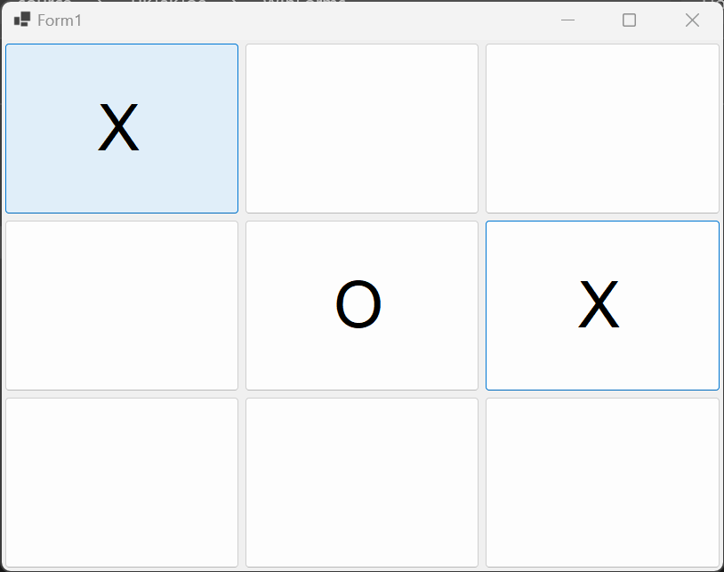
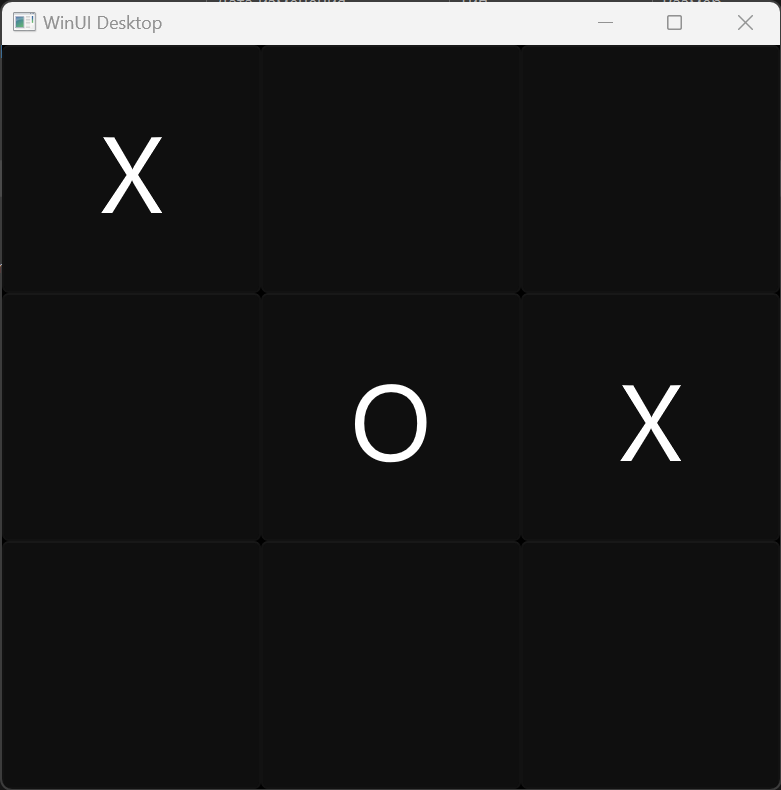
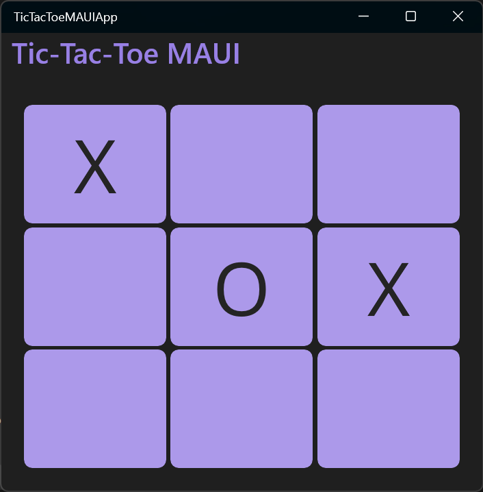
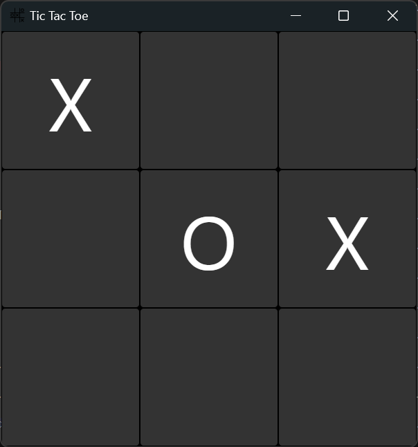
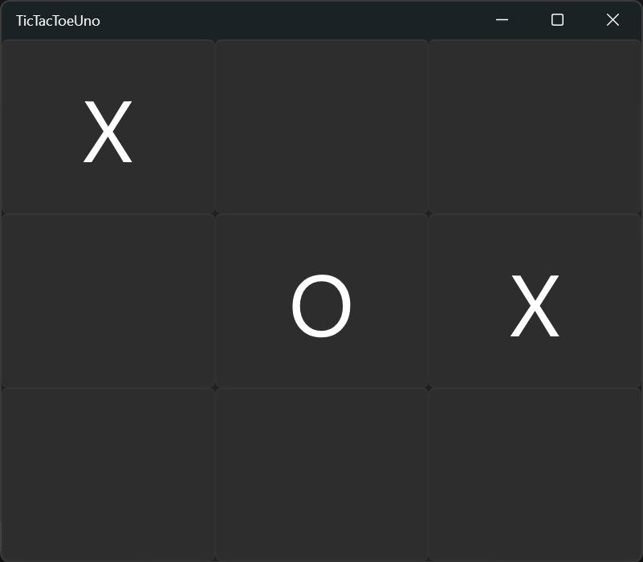
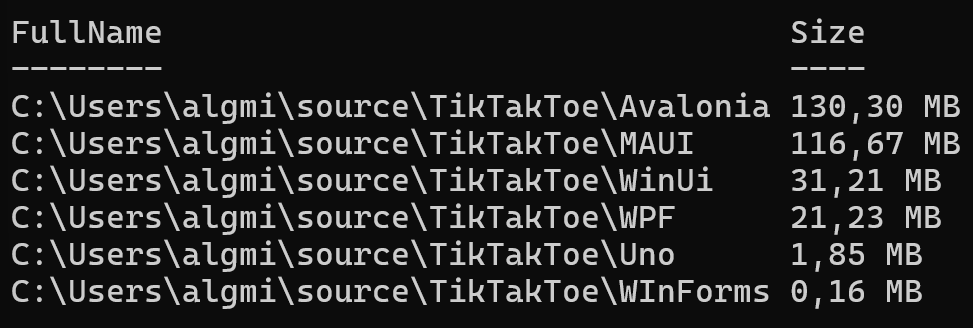

# Comparación de tecnologías para el desarrollo de aplicaciones de escritorio.

Un día, en un chat, surgió la idea de comparar diferentes tecnologías para crear aplicaciones de escritorio, en particular para Windows, utilizando C#. Por supuesto, también se podría hacer con C++, Python, Rust, JS y otros lenguajes, pero como somos desarrolladores de C#, nos interesa más lo que podemos usar directamente sin cambiar de lenguaje.
Al final, lo propuse yo mismo y también lo escribí. 😄
Así que, aplicaciones de escritorio en C#. Se pueden desarrollar utilizando:
- Windows Forms
- WPF
- WinUI
- .NET MAUI
- Avalonia
- Uno Platform

Esta variedad de frameworks se debe a que el lenguaje ha evolucionado, han cambiado los enfoques y se han perfeccionado las tecnologías. Además, en un momento dado, desarrolladores externos se unieron al ecosistema y, junto a las herramientas de Microsoft, se añadieron Avalonia y Uno.

Por lo tanto, para empezar a desarrollar aplicaciones de escritorio, es necesario decidir qué tecnología utilizar. Además, es conveniente entender dónde se ejecutará la aplicación: ¿solo en Windows o también es necesario ejecutarla en macOS y Linux? ¿Y también en iOS y Android?

En general, en este artículo intentaremos analizar las capacidades de estos frameworks y compararlos. Los compararemos según los siguientes criterios:
- Plataformas en las que se puede ejecutar la aplicación
- Complejidad del desarrollo
- Tamaño de la aplicación

Para que la comparación sea justa, utilizaremos la misma lógica para todas las aplicaciones. Más aún, intentaremos hacerlas lo más similares posible entre sí.

## Parte 1. Lógica
Para no comparar aplicaciones vacías sin ninguna funcionalidad, implementé una versión sencilla del juego Tres en Raya (Tic-Tac-Toe). La lógica del juego es simple: hay dos jugadores, X y O. Empieza X, luego le toca a O. El primero en alinear tres de sus símbolos gana; si después del último movimiento no hay un ganador, es un empate.
El código de la lógica se transfiere prácticamente igual de una aplicación a otra, con excepciones por peculiaridades de cada framework. Por ejemplo, Avalonia no tiene un mecanismo incorporado para mostrar diálogos de mensaje (Message Box) y para usarlo hay que instalar un paquete adicional. No es complicado, pero es un matiz. En algunos frameworks no se pueden contar directamente los botones desde la interfaz y hay que buscar soluciones alternativas.
También es importante señalar que, en todos los casos excepto WinForms, lo ideal es usar el patrón MVVM, pero para esta aplicación sencilla no me complicé y todo funciona directamente.

## Parte 2. Interfaz de usuario
El desarrollo de UI en aplicaciones C# no varía demasiado entre sí. Solo destaca WinForms, donde los elementos de la interfaz generalmente se colocan manualmente en un editor gráfico, lo cual es muy amigable para principiantes. También se pueden colocar elementos manualmente en WPF, pero se recomienda construir la interfaz definiendo los parámetros en el código de la página.
Complica el desarrollo visual la falta de vista previa interactiva en MAUI y WinUI, donde solo se puede ver el resultado después de compilar y ejecutar. Sí, existe la función Hot Reload, que muestra los cambios tras una recarga caliente sin reiniciar la aplicación, pero también tiene sus matices. En primer lugar, durante Hot Reload se pierde el estado de la aplicación (a menos que se guarde por separado); por ejemplo, si ya hay varias X y O en el tablero, tras la recarga se "olvidan". En segundo lugar, a veces los cambios no se muestran y aún así hay que reiniciar la aplicación. No es un error, es una característica, como dicen.
En general, uno se acostumbra a todo y, de hecho, volver a WinForms resulta incómodo después: se antoja configurar todo uno mismo.

### Aspecto de las aplicaciones terminadas:
1. Windows Forms: 
2. WPF: 
3. WinUI: 
4. MAUI: 
5. Avalonia: 
6. Uno Platform: 

No me esforcé mucho en hacerlas idénticas, porque no era el objetivo, ni hacía falta. Más aún, se puede notar que algunas se parecen entre sí. Esto se debe al uso de componentes de WinUI. MAUI usa además fuentes nativas y MaterialDesign, de ahí los botones con bordes redondeados. Además, WinUI hereda el tema principal del sistema, por lo que todas, excepto WinForms y WPF, son oscuras. En consecuencia, en las dos primeras hay que añadir manualmente el soporte para temas claro/oscuro.

## Parte 3. Plataformas
Aquí llegamos a las capacidades globales de todos los frameworks. La tabla a continuación muestra para qué plataformas se puede compilar la aplicación.

|                     |     Windows    |     MacOS    |     Linux    |     Android    |     iOS    |
|---------------------|----------------|--------------|--------------|----------------|------------|
|     WinForms        |     +          |              |              |                |            |
|     WPF             |     +          |              |              |                |            |
|     WinUI           |     +          |              |              |                |            |
|     .NET MAUI       |     +          |     +        |              |     +          |     +      |
|     Avalonia        |     +          |     +        |     +        |     +          |     +      |
|     Uno Platform    |     +          |     +        |     +        |     +          |     +      |

Como se puede ver, lógicamente, los seis frameworks permiten crear aplicaciones de escritorio para Windows. Pero hay diferencias. Estas radican tanto en la capacidad multiplataforma de MAUI, Avalonia y Uno, como en los componentes utilizados para renderizar la interfaz gráfica. No profundizaremos demasiado en los detalles, pero es bueno saber que MAUI y Avalonia usan componentes de WinUI, mientras que Uno puede implementar la aplicación de escritorio tanto como WPF como WinUI. Esto puede ser útil en ciertos casos. Además, los frameworks nativos WinForms, WPF y WinUI difieren técnicamente:
- Windows Forms utiliza GDI+ para renderizar la interfaz
- WPF utiliza DirectX para el renderizado
- WinUI utiliza DirectX/DirectComposition para el renderizado

Además, existen diferencias en los componentes, bibliotecas y enfoques utilizados. En otras palabras, todas las tecnologías presentadas en el artículo tienen muchas diferencias con funcionalidades similares, incluso dentro de una misma plataforma objetivo.

## Parte 4. Memoria
Ahora llegamos a la parte cuantitativa de la «investigación». En esta sección, veremos cuánta memoria RAM consumen las aplicaciones. Las compararemos en dos modos: en Visual Studio en modo Debug y en el administrador de tareas con la aplicación publicada en ejecución.

|                     | WinForms   | WPF         | WinUI       | .NET MAUI   | Avalonia    | Uno Platform |
|---------------------|------------|-------------|-------------|-------------|-------------|--------------|
|     Debug (Mb)      |     15     |     80      |     80      |     132     |     82      |     62       |
|     Release (Mb)    |     6,1    |     19,6    |     26,2    |     54,4    |     32,6    |     13,6     |
 
Los resultados son interesantes. Lógicamente, la aplicación de WinForms es la más ligera: consume menos recursos tanto en depuración como en ejecución. Pero con el resto es más interesante. La aplicación más «pesada» resultó ser la de MAUI. Quizás sea un resultado de la capacidad multiplataforma: demasiado "internas". Sin embargo, Uno Platform sorprendió: la aplicación compilada ocupa menos espacio que todas, después de WinForms, y este es un excelente resultado.

Quise medir por separado la velocidad de inicio de las aplicaciones, pero al final decidí no hacerlo. Solo diré que MAUI también pierde aquí, siendo claramente más lento en el arranque que el resto.

## Parte 5. Compilación y despliegue
Unas palabras sobre qué tan complejo es preparar el proyecto para publicarlo y usarlo después. Al publicar aplicaciones, casi todos permiten obtener archivos de biblioteca y un ejecutable, pero solo WinForms y WPF, y sorprendentemente Avalonia, pueden ejecutarse sin instalación. Sin embargo, esto no es gran problema. Lo sería si no fuera por una cosa: para compartir la aplicación o alojarla en algún lugar, se necesita un certificado. Puedes crear uno de prueba en tu máquina, pero uno firmado, para que Windows no lo marque como sospechoso, no se obtiene gratis. Es decir, cuesta dinero y, en la situación actual, también hay que buscar dónde adquirirlo. Además, tiene una validez limitada en el tiempo.
Por supuesto, hay matices y probablemente existan soluciones alternativas, y la cuestión en sí no es de importancia crítica. Pero es bueno conocer estos detalles.

## Parte 6. Conclusión
Bueno, es hora de concluir nuestro pequeño estudio comparativo. ¿Para quién fue realizado? Para aquellos que no han desarrollado aplicaciones de escritorio pero quieren entender qué tecnologías son relevantes. Y estas son las que hemos revisado. Superficialmente, por supuesto, pero no estaba la intención de escribir una enciclopedia sobre cómo crear aplicaciones de escritorio con todos los matices. Sin embargo, sí se puede sacar una conclusión sobre por dónde empezar a sumergirse en el mundo del desarrollo de aplicaciones para Windows, y luego para otras plataformas. Mi visión, basada en la experiencia previa y en lo aprendido ahora, es la siguiente:
- Lo ideal es empezar por la base: Windows Forms. Sí, la tecnología no es nueva e incluso podría considerarse obsoleta. Pero está viva y es funcional. Se pueden practicar muchas técnicas con ella, y crear una aplicación de interfaz gráfica realmente compleja es totalmente viable. De hecho, así se ha hecho durante mucho tiempo.
- El segundo paso debería ser aprender WPF. Esta tecnología permitirá profundizar en el patrón MVVM, el diseño de interfaz en XAML y abrirá el camino hacia stacks más modernos.
- Luego, el camino está abierto para todo. Estuve agradablemente sorprendido por las capacidades de Uno Platform, no las esperaba. Además de poder crear aplicaciones para cualquier sistema operativo actual, incluidos móviles, resulta que esta tecnología es muy respetuosa con los recursos. No es algo crítico en sí, pero cuando el proyecto es grande y se busca optimizar el rendimiento, una aplicación que consume menos recursos parece preferible a mi juicio. Otro aspecto importante: ¡la posibilidad de diseñar la interfaz de Uno en Figma e importar el código directamente al proyecto como XAML! Ningún otro framework revisado ofrece esto.

Y, para terminar, unas palabras sobre el tamaño en disco de las aplicaciones.

En estas carpetas se encuentran los archivos necesarios para la instalación (como en WinUI, MAUI y Uno) o los archivos del proyecto para ejecutar WinForms, WPF y Avalonia.
Y sí, Uno volvió a sorprender, ocupando apenas un poco más que WinForms y casi 70 (!) veces menos que Avalonia.

Esto es todo. Sacad vuestras propias conclusiones, probad a desarrollar aplicaciones de escritorio y ¡mucho éxito!
