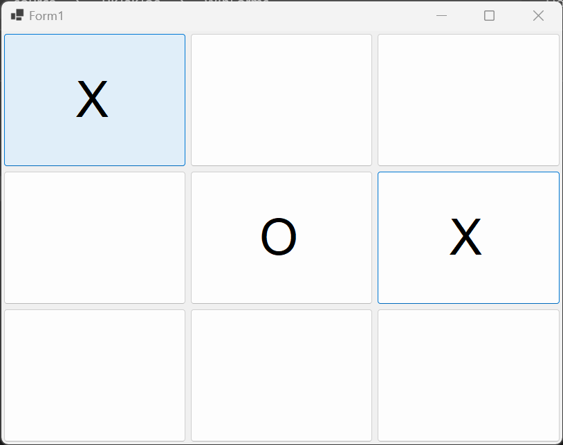
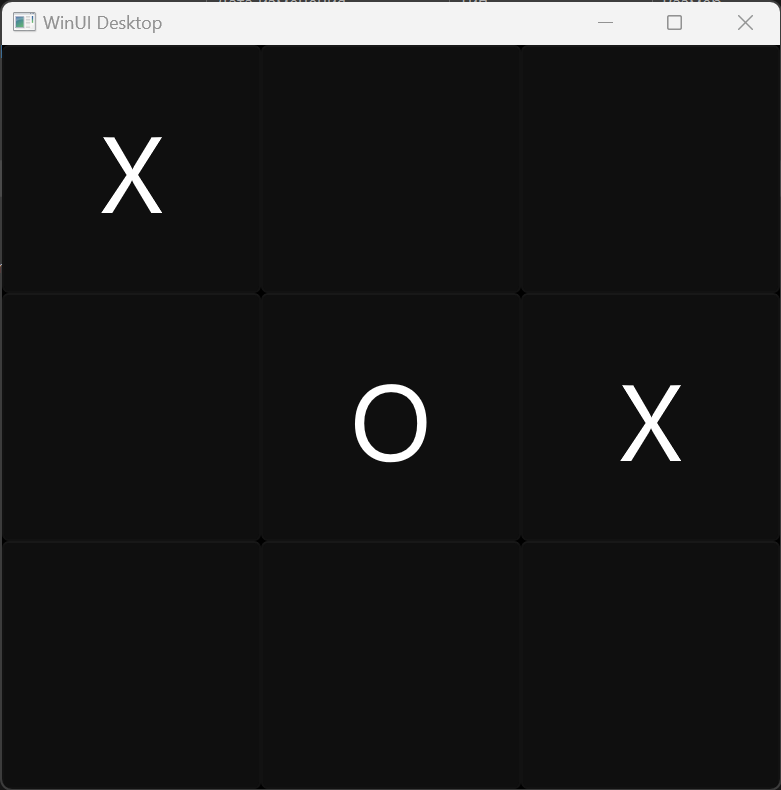
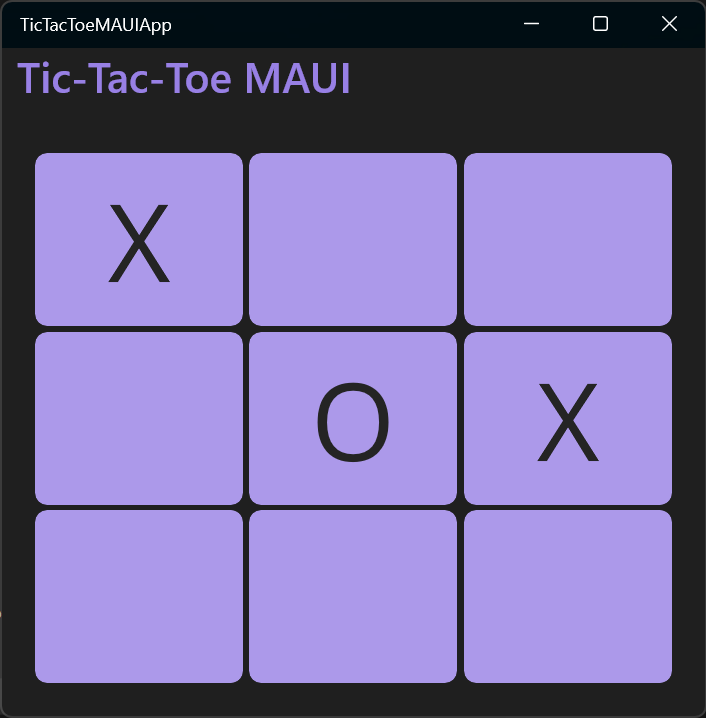
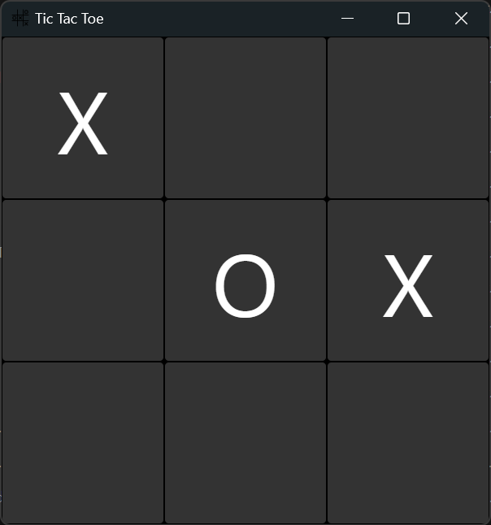
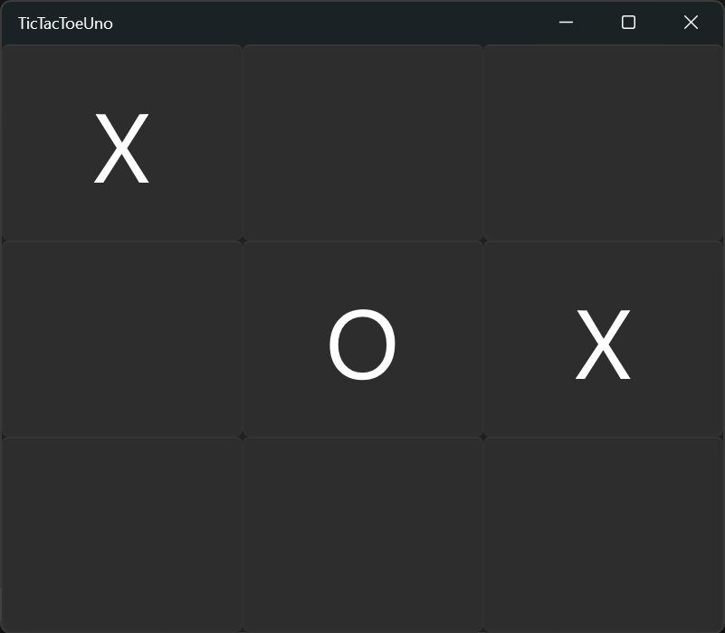

# C# Desktop UI Frameworks — Hands-on Comparison

**[Русская версия / Original Russian research](README.ru.md)**

A practical comparison of six UI frameworks for building desktop applications with C#. This repository accompanies a technical article and provides implementations of the same simple **Tic-Tac-Toe** game, so readers can inspect, build, and compare the approaches themselves.

> **Historical snapshot:** The observations and measurements reflect the framework versions, machine, and setup used when this experiment was conducted. They are not current benchmarks or universal performance rankings.

## Frameworks

| Framework | Windows | macOS | Linux | Android | iOS |
|---|:---:|:---:|:---:|:---:|:---:|
| Windows Forms | ✓ | | | | |
| WPF | ✓ | | | | |
| WinUI | ✓ | | | | |
| .NET MAUI | ✓ | ✓ | | ✓ | ✓ |
| Avalonia | ✓ | ✓ | ✓ | ✓ | ✓ |
| Uno Platform | ✓ | ✓ | ✓ | ✓ | ✓ |

*This table describes the platform support considered in the original comparison; verify current framework support before making architectural decisions.*

## What is compared?

- Developer experience and differences in building the user interface.
- Platform support and deployment considerations.
- Memory consumption in the author's Debug and published application runs.
- Differences in packaging and distributing applications.

All examples implement a small two-player Tic-Tac-Toe game. The application logic is intentionally simple to make framework-specific differences easier to inspect. This is a learning experiment, not a production architecture template; in particular, it does not attempt to demonstrate full MVVM implementations.

## Screenshots

| Windows Forms | WPF | WinUI |
|---|---|---|
|  |  |  |

| .NET MAUI | Avalonia | Uno Platform |
|---|---|---|
|  |  |  |

## Original memory measurements

These are the measurements reported in the original experiment, in MB. They are **not independently reproduced** here.

| Mode | WinForms | WPF | WinUI | .NET MAUI | Avalonia | Uno |
|---|---:|---:|---:|---:|---:|---:|
| Debug | 15 | 80 | 80 | 132 | 82 | 62 |
| Published application | 6.1 | 19.6 | 26.2 | 54.4 | 32.6 | 13.6 |

Measurements depend on runtime, build configuration, framework version, platform, and machine. Do not use them as a general ranking of UI frameworks.

## Explore the examples

1. Clone this repository.
2. Open the relevant framework project or solution in a compatible development environment.
3. Install the required .NET SDKs and platform workloads for that project.
4. Build and run the Tic-Tac-Toe application.
5. Compare the UI code, dependencies, packaging, and runtime behavior.

The examples may require older SDKs or workloads; they have not been updated as part of this documentation refresh.

## Read the complete research

The **[original Russian README](README.ru.md)** contains the full discussion, methodology, screenshots, results, and the author's conclusions. It is preserved without changes.

---

*Created as a reproducible learning exercise and companion to a technical publication.*
